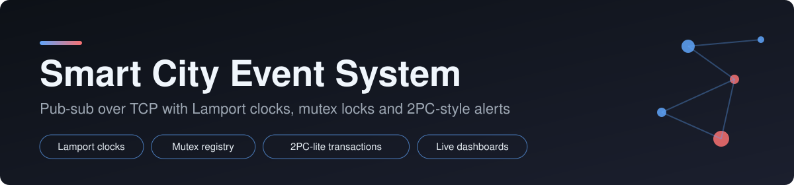
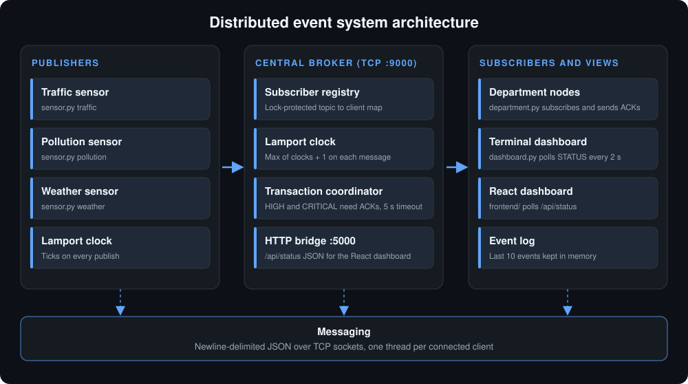

<p align="center">
  
</p>

<h1 align="center">Distributed Pub-Sub Event Notification System</h1>

<p align="center">
  A smart-city alert system built from scratch on raw TCP sockets: sensors publish events, a central broker routes them by topic, and city departments subscribe and acknowledge critical alerts.
</p>

<p align="center">
  
  
  
  
  
</p>

---

## Overview

This project simulates a **smart-city emergency notification network** and doubles as a hands-on demo of core distributed-systems concepts. IoT-style **sensors** (traffic, pollution, weather) publish events to a central **broker**. The broker forwards each event to every **department** subscribed to that topic. Events marked `HIGH` or `CRITICAL` are treated as distributed transactions: the broker waits for every subscriber to acknowledge, and aborts if they do not answer in time.

A small HTTP bridge exposes the broker's live state so a **React dashboard** can show events, subscribers, transactions and the logical clock in real time.

## Architecture

<p align="center">
  
</p>

| Role | Component | Description |
|------|-----------|-------------|
| Publisher | `sensor.py` | Simulates a traffic, pollution or weather sensor and publishes random events every 3 to 8 seconds |
| Broker | `broker.py` | Multi-threaded TCP server (port `9000`) that routes events, keeps the Lamport clock and coordinates transactions |
| Subscriber | `department.py` | A department that subscribes to one topic, prints events and ACKs critical alerts |
| API bridge | built into `broker.py` | HTTP server on port `5000` serving `GET /api/status` as JSON |
| Dashboard | `frontend/` | React UI that polls the API bridge |

## Distributed-systems concepts demonstrated

- **Publish/Subscribe messaging.** Sensors never talk to departments directly. The broker decouples them by topic.
- **Lamport logical clocks.** Every message carries a `lamport` timestamp. On receive, each node applies `time = max(local, received) + 1`, which gives a consistent causal ordering without synchronised wall clocks.
- **Mutual exclusion.** The subscriber registry, the clock and the transaction table are each guarded by a thread lock, so many client threads can use them safely.
- **Two-phase-commit (2PC-lite).** For `HIGH` and `CRITICAL` events the broker opens a transaction with a short ID, waits for an ACK from every subscriber, then marks it `COMMITTED`. If any ACK is missing after **5 seconds**, it is marked `ABORTED`.
- **RPC-style messaging.** Newline-delimited JSON requests (`SUBSCRIBE`, `PUBLISH`, `ACK`, `STATUS`) with typed replies.
- **Concurrency.** One thread per client connection plus a background thread for the HTTP bridge.

## Message protocol

All messages are JSON objects terminated by `\n`.

| Type | Direction | Fields |
|------|-----------|--------|
| `SUBSCRIBE` | department to broker | `department`, `topic`, `lamport` |
| `SUBSCRIBED` | broker to department | `topic`, `lamport` |
| `PUBLISH` | sensor to broker | `sensor`, `topic` (optional, defaults to the sensor-name prefix), `data`, `severity`, `lamport` |
| `EVENT` | broker to departments | `sensor`, `topic`, `data`, `severity`, `lamport`, `tx_id` (only for HIGH/CRITICAL) |
| `ACK` | department to broker | `tx_id`, `department`, `lamport` |
| `STATUS` / `STATUS_REPLY` | any client / broker | Snapshot of clock, recent events, subscribers and transactions |

Severity levels: `LOW`, `MEDIUM`, `HIGH`, `CRITICAL`.

## Project structure

```
distributed-event-system/
├── broker.py        # central broker: routing, Lamport clock, 2PC coordinator, HTTP bridge
├── sensor.py        # publisher: traffic | pollution | weather
├── department.py    # subscriber: topic listener + ACK sender
├── dashboard.py     # dashboard utility
├── mock.py          # mock / test helper
├── run_demo.py      # single-process demo script
├── frontend/        # React dashboard
└── assets/          # banner.svg, architecture.svg
```

## Getting started

### Prerequisites

- Python 3.8 or newer (standard library only, nothing to `pip install`)
- Node.js 18 or newer (for the dashboard)

### 1. Start the broker

```bash
python broker.py
```

The broker listens on TCP `0.0.0.0:9000` and serves the dashboard API on `0.0.0.0:5000`.

### 2. Start one or more departments

```bash
# python department.py <department_name> <topic> [broker_ip]
python department.py FireDept traffic 127.0.0.1
python department.py HealthDept pollution 127.0.0.1
python department.py DisasterDept weather 127.0.0.1
```

### 3. Start one or more sensors

```bash
# python sensor.py <traffic|pollution|weather> [broker_ip]
python sensor.py traffic 127.0.0.1
python sensor.py pollution 127.0.0.1
python sensor.py weather 127.0.0.1
```

> **Note:** if `broker_ip` is omitted, `sensor.py` and `department.py` fall back to the LAN address `10.10.16.136`. Always pass your broker's IP (use `127.0.0.1` on a single machine, or the broker machine's LAN IP when running across several laptops).

### 4. Start the dashboard

```bash
cd frontend
npm install
npm run dev      # check frontend/package.json for the exact script name
```

The dashboard reads from `http://<broker-ip>:5000/api/status`.

## API

`GET /api/status` returns:

```json
{
  "lamport": 42,
  "events": [
    { "id": 0, "time": "14:03:12", "source": "traffic-sensor", "data": "Heavy congestion detected near City Center junction", "severity": "MEDIUM" }
  ],
  "subscribers": { "traffic": ["FireDept"] },
  "transactions": [
    { "tx_id": "a1b2c3d4", "status": "COMMITTED", "nodes": ["FireDept"] }
  ]
}
```

The last 10 events and last 5 transactions are kept in memory.

## What happens on a CRITICAL event

1. A sensor publishes `{"type":"PUBLISH", "severity":"CRITICAL", ...}`.
2. The broker updates its Lamport clock and finds all subscribers of the topic.
3. It starts a transaction (`tx_id`), status `PENDING`, and starts a 5 second timer.
4. It sends an `EVENT` carrying the `tx_id` to every subscriber.
5. Each department prints the alert and replies with an `ACK`.
6. When every expected ACK arrives the transaction becomes `COMMITTED`. If the timer fires first, it becomes `ABORTED`.

## Team

| Member | Component |
|--------|-----------|
| Nartan and Daiyan | Broker, Lamport clock, mutex locks, 2PC coordinator, HTTP API, dashboard |
| Manoj | Sensor (publisher) |
| Farhaan | Department (subscriber) |

## Possible extensions

- Persist events and transactions to disk
- Retry or re-delivery for aborted transactions
- Authentication on the TCP channel
- Replace polling with WebSockets for the dashboard
